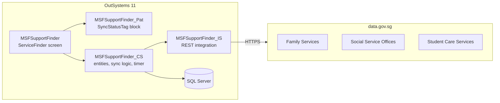
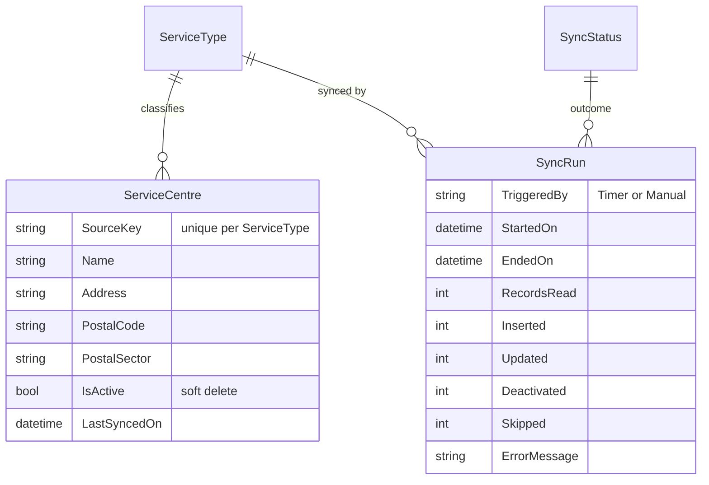
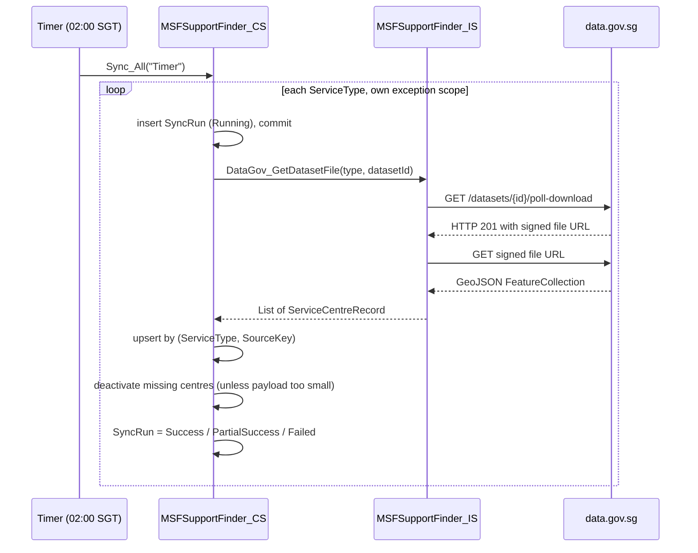
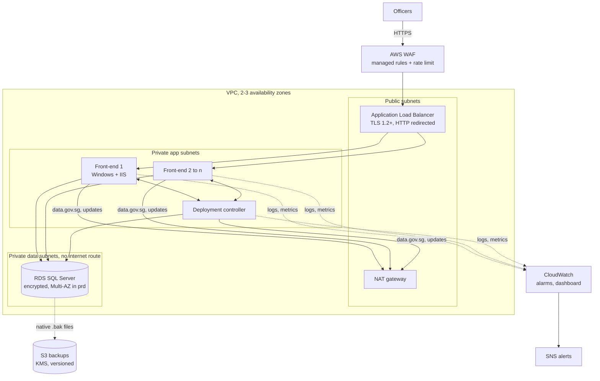

# MSF Service Directory

An OutSystems 11 application that keeps a searchable directory of MSF support centres
(Family Service Centres, Social Service Offices and Student Care Centres) in sync with the
public datasets on data.gov.sg. A nightly timer refreshes the directory; officers search it
by name, type and postal sector.

This repository holds everything around the OutSystems solution:

| Deliverable | Location |
|---|---|
| Infrastructure as Code | [`infra/terraform`](infra/terraform) |
| Automated tests | [`tests`](tests) |
| CI pipeline | [`.github/workflows/ci.yml`](.github/workflows/ci.yml) |
| Documentation | this file |

The application itself is submitted as an OutSystems Solution Pack (`.osp`).

> The only data used is the public directory of service centres published by MSF on
> data.gov.sg. The application stores no personal data.

---

## Contents

1. [The application](#1-the-application)
2. [Data sources](#2-data-sources)
3. [Getting started](#3-getting-started)
4. [Infrastructure as Code](#4-infrastructure-as-code)
5. [Automated tests](#5-automated-tests)
6. [CI pipeline](#6-ci-pipeline)
7. [Operations runbook](#7-operations-runbook)
8. [Design decisions and trade-offs](#8-design-decisions-and-trade-offs)
9. [Scope and next steps](#9-scope-and-next-steps)

```
.
├── .github/workflows/ci.yml     IaC checks, contract tests, e2e tests
├── infra/terraform/             AWS hosting for a self-managed OutSystems 11 environment
│   ├── environments/            dev / prd variable files, backend config example
│   └── scripts/                 Windows server bootstrap (IIS, TLS hardening, CloudWatch agent)
└── tests/
    ├── contract/                data.gov.sg contract tests and fixture tests
    ├── e2e/                     Playwright browser tests against the deployed app
    ├── fixtures/geojson/        sample and broken payloads
    └── src/                     dataset field mappings and contract rules
```

---

## 1. The application

### Who uses it

| Role | Can do |
|---|---|
| Any signed-in user | Search and filter the directory, see when each dataset was last synced |
| SyncAdmin | Everything above, plus start a sync on demand |

### Architecture



Dependencies only point downward. The screen never calls the external API directly, and the
integration module never touches entities, so a change in the data source is contained in
one module.

| Module | Type | Responsibility |
|---|---|---|
| `MSFSupportFinder_IS` | Service | Consumes the data.gov.sg API; maps each dataset's schema to one `ServiceCentreRecord` structure; turns any failure into `Success = False` with a readable message |
| `MSFSupportFinder_CS` | Service | Entities, sync logic, `Timer_SyncServiceCentres`, `SyncAdmin` role, site properties |
| `MSFSupportFinder_Pat` | Library | `SyncStatusTag` block, which takes plain inputs and has no data dependency |
| `MSFSupportFinder` | Reactive Web App | `ServiceFinder` screen |

### Data model



`ServiceType` and `SyncStatus` are static entities. `SyncRun` is the sync's own audit log:
every run, manual or scheduled, leaves one row per dataset with its counts and any error.

### Nightly sync



If the API is down or returns something unexpected, the run is marked `Failed`, the error is
stored on `SyncRun`, and the existing directory stays untouched. Users keep searching the last
good data.

**Sync now** does not run the sync inside the button's request. It wakes the timer, so the
request returns at once and the sync runs under the timer's longer timeout.

---

## 2. Data sources

| Service type | Dataset | ID | Records* |
|---|---|---|---|
| Family Service Centre | Family Services (GEOJSON) | `d_add23c06f7267e799185c79ccaa2099b` | 55 |
| Social Service Office | Social Service Offices (GEOJSON) | `d_22cfe2aed0bf20a679ab59bcaf0f8248` | 24 |
| Student Care Centre | Student Care Services (GEOJSON) | `d_77e6e0d58ce4743dab1f26dfcbbeb6f4` | 336 |

\* As of November 2026.

### What the live data showed

Profiling the three files before building the integration turned up several issues. The
contract tests now check for each of them.

| Finding | Effect on the design |
|---|---|
| The three datasets have **different schemas** (`NAME` vs `NAME_OF_STUDENT_CARE_CENTRE`, `ADDRESSPOSTALCODE` vs `POSTALCODE` vs `SCC_POSTAL_CODE`) | One mapping per dataset in the IS module; CS only sees the common `ServiceCentreRecord` |
| Some postal codes have **lost their leading zero** (`088995` arrives as `88995`) | 5-digit codes are padded; anything that is not 5 or 6 digits is skipped and counted |
| `poll-download` answers **HTTP 201**, not 200 | The REST consume treats any 2xx as success |
| An unknown dataset ID returns **404** with `{"error": "..."}` and no `code` field | The error message is passed through to `SyncRun.ErrorMessage` |
| Anonymous calls are **rate limited (HTTP 429)** | Optional API key in a site property; datasets are fetched one at a time; a 429 fails that dataset's run and the next run retries |
| The file URL is a **signed S3 link** that changes on every call | The URL travels in a header and `OnBeforeRequest` sets it as the request URL |
| Student Care has a stable `UNIQUE_ID`; FSC and SSO only have `OBJECTID`, which can change when the file is republished | Source key is `UNIQUE_ID` for Student Care and `NAME + postal code` for FSC and SSO |

The field mappings live in [`tests/src/datasets.ts`](tests/src/datasets.ts) and match the
mapping actions in `MSFSupportFinder_IS`.

---

## 3. Getting started

1. In Service Center, go to **Factory > Solutions > Upload and Publish** and select the `.osp`.
2. In Service Center, open `MSFSupportFinder_CS` and review the site properties:

   | Site property | Default | Notes |
   |---|---|---|
   | `DataGov_DatasetId_FSC` | `d_add23c06f7267e799185c79ccaa2099b` | |
   | `DataGov_DatasetId_SSO` | `d_22cfe2aed0bf20a679ab59bcaf0f8248` | |
   | `DataGov_DatasetId_StudentCare` | `d_77e6e0d58ce4743dab1f26dfcbbeb6f4` | |
   | `DataGov_ApiKey` | empty | Optional, raises the rate limit |
   | `Sync_IsEnabled` | `True` | Kill switch for the timer |
   | `Sync_MinRecordsGuard` | `5` | Below this, centres are not deactivated |

   The data.gov.sg base URL is the REST API's effective URL, also changeable per environment in
   Service Center (`MSFSupportFinder_IS` > Integrations).
3. In the Users application, give the `SyncAdmin` role to the users who may start a sync. The e2e tests use `edward.williams@example.com` (no role) and `andrea.mccarthy@example.com` (`SyncAdmin`).
4. Sign in as `admin1` and choose **Sync now**, or wait for the 02:00 timer.

---

## 4. Infrastructure as Code

### Scope

The assessment build runs in an OutSystems Personal Environment, which OutSystems hosts.
The Terraform here describes where the application would run in production: a
**self-managed OutSystems 11 environment on AWS**, as used under the Government Commercial
Cloud (GCC). The same code is used for each environment, with different variable files.



### What it creates

| Area | Resources | Why |
|---|---|---|
| Network | VPC, public / app / data subnets per AZ, NAT, flow logs, locked-down default security group | Three tiers; the database has no route to the internet |
| Edge | ALB with HTTPS listener, HTTP-to-HTTPS redirect, access logs, WAF with logging | Single entry point, TLS 1.2+, managed rule sets, rate limiting |
| Compute | Deployment controller + `frontend_count` front-ends, Windows Server 2022 | Front-ends spread across AZs; IMDSv2 only; encrypted volumes |
| Access | SSM Session Manager, no key pairs, no RDP/SSH ingress | Administration is audited and needs no open ports |
| Database | RDS SQL Server, KMS encryption, `rds.force_ssl`, Secrets Manager password, Performance Insights, enhanced monitoring | Credentials never appear in code or outputs |
| Backup & DR | RDS automated backups (point-in-time restore), native `.bak` to S3, AWS Backup for servers, Multi-AZ in prd | Restore points at database, file and server level |
| Patching | SSM patch baseline for critical and security updates | Patching without rebuilding servers |
| Observability | CloudWatch agent (event logs, IIS logs, disk, memory), alarms for 5xx, unhealthy hosts, latency, status checks, DB CPU and storage, dashboard, SNS | Each alarm says where to look next |
| Encryption | One customer-managed KMS key with rotation | Logs, volumes, database, backups, SNS |

### What is deliberately not automated

* **Installing the OutSystems Platform Server.** The installer and licence are not stored
  in this repository. The bootstrap script prepares the servers (IIS, .NET features, TLS
  hardening, CloudWatch agent). The Platform Server is then installed and configured with the
  Configuration Tool, pointing at the `db_endpoint` output and the credentials in
  `db_master_secret_arn`.
* **Registering the environment in LifeTime** and deploying applications. Application
  deployments go through LifeTime, not Terraform.

### Usage

```bash
cd infra/terraform

# one-time: copy and edit the backend settings (S3 state bucket + DynamoDB lock table)
cp environments/dev.backend.hcl.example environments/dev.backend.hcl

terraform init -backend-config=environments/dev.backend.hcl
terraform plan -var-file=environments/dev.tfvars -out=dev.tfplan
terraform apply dev.tfplan
```

Before applying, set `allowed_ingress_cidrs` and `certificate_arn` in the variable file. Check
`db_engine_version` against `aws rds describe-db-engine-versions --engine sqlserver-se`, and
`platform_ports` against the network requirements for the Platform Server version you install.

| Setting | dev | prd |
|---|---|---|
| Availability zones | 2 | 3 |
| NAT gateways | 1 shared | 1 per AZ |
| Front-ends | 1 | 3 |
| Database Multi-AZ | no | yes |
| Backup retention | 7 days | 35 days |
| Deletion protection | off | on |
| Log retention | 90 days | 365 days |

### GCC notes

GCC accounts come with guardrails (SCPs, central logging, approved regions) that are
managed centrally. This code stays in `ap-southeast-1`, creates no public S3 buckets and no
IAM users, and tags every resource with `Project`, `Environment`, `Owner` and `ManagedBy`,
so it fits within those guardrails. Depending on the agency setup, internet egress may go
through a central egress VPC instead of the NAT gateway created here.

---

## 5. Automated tests

| Layer | What it checks | Needs | Command |
|---|---|---|---|
| Fixture tests | Field mappings, postal code rules, and that each fixture shows the case it is named after | Nothing | `npm run test:offline` |
| Contract tests | The live data.gov.sg API and files still match what the integration expects | Internet | `npm run test:contract` |
| End-to-end tests | Directory search and filters, empty state, Sync now, role restriction, sign-in redirect | Deployed app + test users | `npm run test:e2e` |

### Latest end-to-end run

24 November 2026, against the Personal Environment, in Chrome: **11 passed** (2 sign-in
steps and 9 tests) in 2.8 minutes. The two test users are `edward.williams@example.com`
(no role) and `andrea.mccarthy@example.com` (`SyncAdmin`); their password is not stored in
this repository.

Writing the tests surfaced two issues that were fixed in the app: a `data-testid` attached to
the wrong widget, and a type filter without an "All types" option. The suite also needed
longer waits, because a Personal Environment can take over 10 seconds to load a screen
for the first time.

### Run locally

```bash
cd tests
npm ci
npx playwright install chromium   # only needed for e2e

npm run test:contract             # fixtures + live API

cp .env.example .env              # then fill in the app URL and test user passwords
npm run test:e2e
```

Behind a corporate proxy that inspects TLS, Node needs the system certificate store:
`NODE_OPTIONS=--use-system-ca npm run test:contract`.

### Why contract tests

The application depends on a public API it does not control. The contract tests run the same
rules the sync applies (structure, required fields, postal codes, coordinates inside
Singapore, unique source keys) against the live files. They run daily at 01:00 SGT, an hour
before the sync timer, so an upstream change fails the pipeline before it fails the sync.

### Fixtures

`tests/fixtures/geojson` holds small real samples of each dataset and broken payloads:
`empty-collection`, `missing-fields`, `malformed`, and the API's `not-geojson` error body.

### Test IDs

The end-to-end tests find widgets by `data-testid`, set in Service Studio under the widget's
**Attributes**. This keeps the tests independent of styling and widget names.

| Widget on `ServiceFinder` | Test ID |
|---|---|
| Search input | `finder-search` |
| Type dropdown | `finder-type` |
| Postal sector input (optional) | `finder-sector` |
| Name expression in each table row | `centre-name` |
| Type expression in each table row | `centre-type` |
| Container shown when the table is empty | `empty-state` |
| `SyncStatusTag` block root (one per service type) | `sync-status` |
| Expression with the latest sync time | `sync-last-run` |
| Sync now button | `sync-now` |

The sign-in step works with the default Login screen; `login-username`, `login-password` and
`login-submit` are used instead if present.

---

## 6. CI pipeline

[`.github/workflows/ci.yml`](.github/workflows/ci.yml)

| Job | Runs on | Steps |
|---|---|---|
| IaC | push, pull request | `terraform fmt -check`, `validate`, TFLint, Checkov security scan |
| Contract tests | push, pull request, daily 01:00 SGT | type check, fixture tests, live contract tests; report uploaded |
| End-to-end tests | manual (`run_e2e`) | Playwright against the deployed app; trace and screenshots kept on failure |

To run the browser tests with the installed Chrome instead of downloading one, set `PW_CHANNEL=chrome`.

E2E credentials come from the `personal-env` GitHub environment: usernames and
`APP_BASE_URL` as variables, passwords as secrets. Nothing sensitive is committed. Checkov
exceptions are listed with reasons in [`infra/terraform/.checkov.yaml`](infra/terraform/.checkov.yaml).

---

## 7. Operations runbook

| Symptom | Where to look | Likely cause and action |
|---|---|---|
| A status tag shows `Failed` | `SyncRun.ErrorMessage`; Service Center > Monitoring > Integrations | API down or 429: next run retries; use **Sync now** later or set `DataGov_ApiKey`. 404: dataset ID changed, update the site property |
| Status `PartialSuccess` | `SyncRun.RecordsRead`, `SyncRun.Skipped` | Payload smaller than `Sync_MinRecordsGuard` (deactivation skipped), or some records had invalid postal codes |
| Many records `Skipped` | Daily contract test run | Field renamed upstream: update the mapping in `MSFSupportFinder_IS` and `tests/src/datasets.ts` together |
| Timer did not run | Service Center > Monitoring > Timers; Environment Health | `Sync_IsEnabled` is false, or the scheduler service is stopped |
| `SignatureDoesNotMatch` from S3 | Integration log for `DataGovFile` | The signed URL was altered; check `OnBeforeRequest` sets `BaseURL` to the full URL and `URLPath` to empty |
| Slow search | Service Center > Monitoring > Slow queries; RDS Performance Insights | Missing index or an aggregate fetching too many rows |

---

## 8. Design decisions and trade-offs

* **Nightly sync instead of live calls.** Search is fast and keeps working when data.gov.sg
  is unavailable. The directory can be up to a day old, which is acceptable for centre
  addresses.
* **Soft delete for centres.** A centre that drops out of the dataset is hidden, not deleted,
  so anything that later references it (such as referrals) stays valid.
* **Small-payload guard.** A broken or empty response cannot wipe the directory. The cost is
  that someone has to check when the guard trips.
* **Manual sync wakes the timer.** The request returns immediately and the sync runs under the
  timer's timeout instead of the screen request's.
* **Authorisation on the server.** `Sync_Now` checks the `SyncAdmin` role itself; hiding the
  button is for convenience, not security.
* **Postal sector filter instead of distance.** It avoids a geocoding dependency. The stored
  coordinates allow distance sorting later (for example with OneMap).

## 9. Scope and next steps

This build is the directory and its data pipeline. The data model was designed so the
following can be added without changing what exists:

1. **Referral tracking**: `Client`, `Referral` and an insert-only `ReferralStatusHistory`
   audit trail, with a Submitted, Accepted, Rejected, Closed and Withdrawn lifecycle enforced
   on the server.
2. **Distance search**: geocode a postal code with OneMap and sort centres by distance using
   the stored coordinates.
3. **Load sample data**: run the bundled fixtures through the same mapping path, as a
   fallback when data.gov.sg is unreachable.

Known limitation: the Terraform has not been applied to a live AWS account as part of this
assessment; it is validated and scanned in CI.
