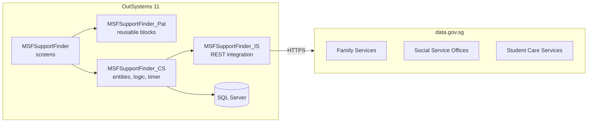
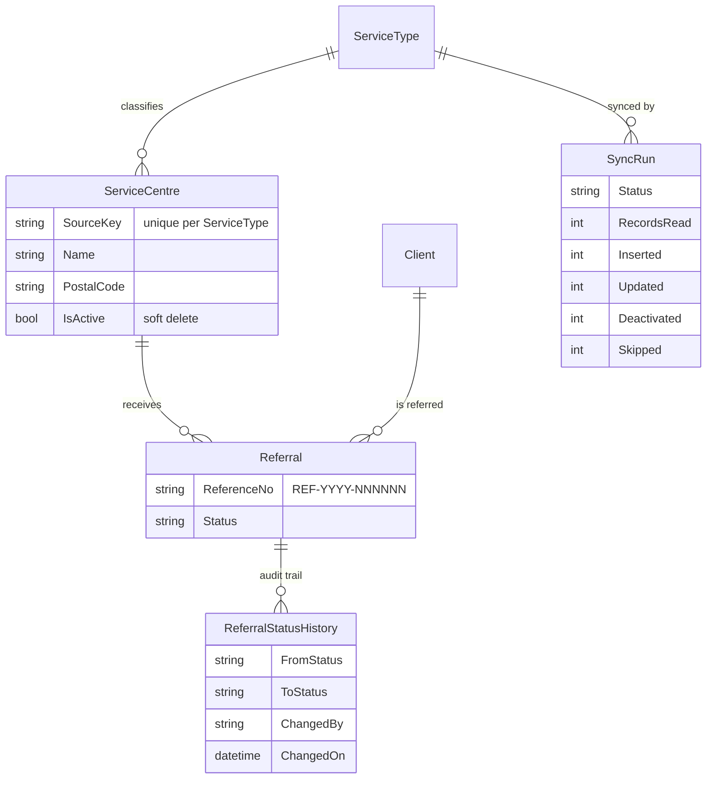
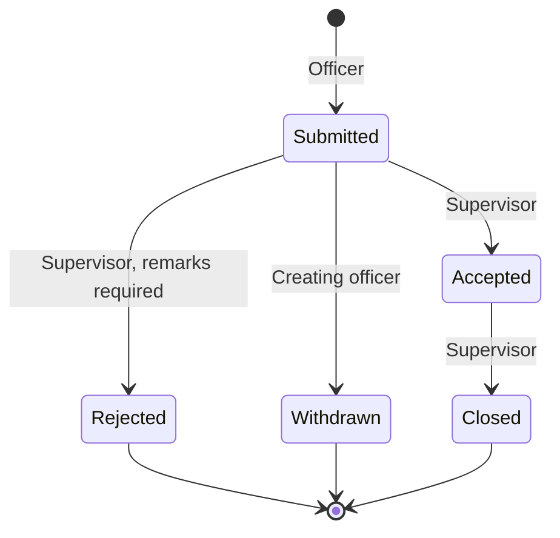
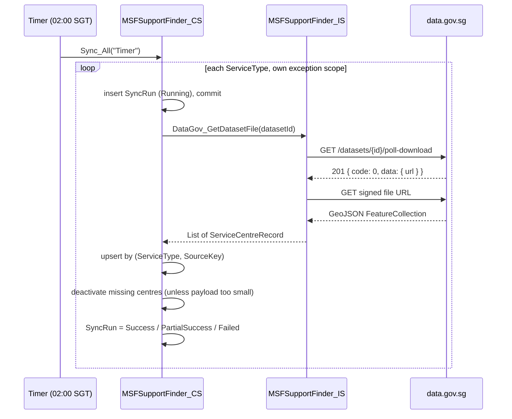

# MSF Support Services Finder & Referral Tracker

An OutSystems 11 application that lets social service officers find MSF support centres
(Family Service Centres, Social Service Offices and Student Care Centres) from the
public datasets on data.gov.sg, refer a client to one, and track the referral to closure.

This repository holds everything around the OutSystems solution:

| Deliverable | Location |
|---|---|
| Infrastructure as Code | [`infra/terraform`](infra/terraform) |
| Automated tests | [`tests`](tests) |
| CI pipeline | [`.github/workflows/ci.yml`](.github/workflows/ci.yml) |
| Documentation | this file |

The application itself is submitted as an OutSystems Solution Pack (`.osp`).

> All client data in the application is synthetic. The only real data used is the public
> directory of service centres published by MSF on data.gov.sg.

---

## Contents

1. [The application](#1-the-application)
2. [Data sources](#2-data-sources)
3. [Getting started](#3-getting-started)
4. [Infrastructure as Code](#4-infrastructure-as-code)
5. [Automated tests](#5-automated-tests)
6. [CI pipeline](#6-ci-pipeline)
7. [Operations runbook](#7-operations-runbook)
8. [Design decisions and trade-offs](#8-design-decisions-and-trade-offs)
9. [Known limitations](#9-known-limitations)

```
.
├── .github/workflows/ci.yml     IaC checks, contract tests, e2e tests
├── infra/terraform/             AWS hosting for a self-managed OutSystems 11 environment
│   ├── environments/            dev / prd variable files, backend config example
│   └── scripts/                 Windows server bootstrap (IIS, TLS hardening, CloudWatch agent)
└── tests/
    ├── contract/                data.gov.sg contract tests and fixture tests
    ├── e2e/                     Playwright browser tests against the deployed app
    ├── fixtures/geojson/        sample and broken payloads, also bundled in the app
    └── src/                     dataset field mappings and contract rules
```

---

## 1. The application

### Who uses it

| Role | Can do |
|---|---|
| Officer | Search centres, refer a client, withdraw own referrals, view referrals |
| Supervisor | Everything an officer can, plus accept, reject and close referrals |
| SyncAdmin | View sync history, run a sync on demand, load sample data |

### Architecture



Dependencies only point downward. Screens never call the external API directly, and the
integration module never touches entities, so a change in the data source is contained in
one module.

| Module | Responsibility |
|---|---|
| `MSFSupportFinder_IS` | Consumes the data.gov.sg API, maps each dataset's schema to one clean `ServiceCentreRecord` structure |
| `MSFSupportFinder_CS` | Entities, business rules, role checks, `Timer_SyncServiceCentres`, site properties |
| `MSFSupportFinder_Pat` | UI blocks with plain inputs: `StatusTag`, `ServiceCentreCard`, `StatusTimeline`, `ErrorBanner`, `EmptyState` |
| `MSFSupportFinder` | Screens: Service Finder, Centre Detail, New Referral, Referral List, Referral Detail, Sync Status |

### Data model



### Referral lifecycle



Transitions are enforced in `Referral_ChangeStatus` on the server, not only by hiding
buttons. Every change writes a row to `ReferralStatusHistory`, which is insert-only.

### Nightly sync



If the API is down or returns something unexpected, the run is marked `Failed`, the error is
stored on `SyncRun`, and the existing directory stays untouched. Officers keep working on
the last good data.

---

## 2. Data sources

| Service type | Dataset | ID | Records* |
|---|---|---|---|
| Family Service Centre | Family Services (GEOJSON) | `d_add23c06f7267e799185c79ccaa2099b` | 55 |
| Social Service Office | Social Service Offices (GEOJSON) | `d_22cfe2aed0bf20a679ab59bcaf0f8248` | 24 |
| Student Care Centre | Student Care Services (GEOJSON) | `d_77e6e0d58ce4743dab1f26dfcbbeb6f4` | 336 |

\* As of November 2026.

### What the live data showed

Profiling the three files before building the integration turned up several issues. The
contract tests now check for each of them.

| Finding | Effect on the design |
|---|---|
| The three datasets have **different schemas** (`NAME` vs `NAME_OF_STUDENT_CARE_CENTRE`, `ADDRESSPOSTALCODE` vs `POSTALCODE` vs `SCC_POSTAL_CODE`) | One mapping per dataset in the IS module; CS only sees the common `ServiceCentreRecord` |
| Some postal codes have **lost their leading zero** (`088995` arrives as `88995`) | 5-digit codes are padded; anything that is not 5 or 6 digits is skipped and counted |
| `poll-download` answers **HTTP 201**, not 200 | The REST consume treats any 2xx as success |
| An unknown dataset ID returns **404** with `{"error": "..."}` and no `code` field | The error message is passed through to `SyncRun.ErrorMessage` |
| Anonymous calls are **rate limited (HTTP 429)** | Optional API key in a site property; datasets are fetched one at a time; a 429 fails that dataset's run and the next run retries |
| Student Care has a stable `UNIQUE_ID`; FSC and SSO only have `OBJECTID`, which can change when the file is republished | Source key is `UNIQUE_ID` for Student Care and `NAME + postal code` for FSC and SSO |

The field mappings live in [`tests/src/datasets.ts`](tests/src/datasets.ts) and match the
mapping actions in `MSFSupportFinder_IS`.

---

## 3. Getting started

### Install the application

1. In Service Center, go to **Factory > Solutions > Upload and Publish**, and select the `.osp`.
2. In Service Center, open `MSFSupportFinder_CS` and review the site properties:

   | Site property | Default | Notes |
   |---|---|---|
   | `DataGov_BaseUrl` | `https://api-open.data.gov.sg/v1/public/api` | |
   | `DataGov_DatasetId_FSC` | `d_add23c06f7267e799185c79ccaa2099b` | |
   | `DataGov_DatasetId_SSO` | `d_22cfe2aed0bf20a679ab59bcaf0f8248` | |
   | `DataGov_DatasetId_StudentCare` | `d_77e6e0d58ce4743dab1f26dfcbbeb6f4` | |
   | `DataGov_ApiKey` | empty | Optional, raises the rate limit |
   | `Sync_IsEnabled` | `True` | Kill switch for the timer |
   | `Sync_MinRecordsGuard` | `5` | Below this, centres are not deactivated |

3. In the Users application, create the test users and assign roles:
   `officer1` (Officer), `supervisor1` (Supervisor), `admin1` (SyncAdmin).
4. Sign in as `admin1`, open **Sync Status** and choose **Sync now**, or wait for the
   02:00 timer. If data.gov.sg is unreachable, choose **Load sample data**, which loads the
   fixtures in `tests/fixtures/geojson` that are bundled with the app.

The bootstrap timer seeds ten synthetic clients (`Test Client 01` to `Test Client 10`) on the
first publish.

---

## 4. Infrastructure as Code

### Scope

The assessment build runs in an OutSystems Personal Environment, which OutSystems hosts.
The Terraform here describes where the application would run in production: a
**self-managed OutSystems 11 environment on AWS**, as used under the Government Commercial
Cloud (GCC). The same code is used for each environment, with different variable files.

```mermaid
flowchart TB
    U[Officers] -->|HTTPS| WAF[AWS WAF<br/>managed rules + rate limit]
    WAF --> ALB[Application Load Balancer<br/>TLS 1.2+, HTTP redirected]

    subgraph VPC[VPC, 2-3 availability zones]
        subgraph PUB[Public subnets]
            ALB
            NAT[NAT gateway]
        end
        subgraph APP[Private app subnets]
            FE1[Front-end 1<br/>Windows + IIS]
            FE2[Front-end 2..n]
            DC[Deployment controller]
        end
        subgraph DATA[Private data subnets, no internet route]
            RDS[(RDS SQL Server<br/>encrypted, Multi-AZ in prd)]
        end
    end

    ALB --> FE1 & FE2
    FE1 & FE2 <--> DC
    FE1 & FE2 & DC --> RDS
    FE1 & FE2 & DC -->|data.gov.sg, updates| NAT
    RDS -.native .bak.-> S3[(S3 backups<br/>KMS, versioned)]
    FE1 & FE2 & DC -.logs, metrics.-> CW[CloudWatch<br/>alarms, dashboard]
    CW --> SNS[SNS alerts]
```

### What it creates

| Area | Resources | Why |
|---|---|---|
| Network | VPC, public / app / data subnets per AZ, NAT, flow logs, locked-down default security group | Three tiers; the database has no route to the internet |
| Edge | ALB with HTTPS listener, HTTP-to-HTTPS redirect, access logs, WAF with logging | Single entry point, TLS 1.2+, managed rule sets, rate limiting |
| Compute | Deployment controller + `frontend_count` front-ends, Windows Server 2022 | Front-ends spread across AZs; IMDSv2 only; encrypted volumes |
| Access | SSM Session Manager, no key pairs, no RDP/SSH ingress | Administration is audited and needs no open ports |
| Database | RDS SQL Server, KMS encryption, `rds.force_ssl`, Secrets Manager password, Performance Insights, enhanced monitoring | Credentials never appear in code or outputs |
| Backup & DR | RDS automated backups (point-in-time restore), native `.bak` to S3, AWS Backup for servers, Multi-AZ in prd | Restore points at database, file and server level |
| Patching | SSM patch baseline for critical and security updates | Patching without rebuilding servers |
| Observability | CloudWatch agent (event logs, IIS logs, disk, memory), alarms for 5xx, unhealthy hosts, latency, status checks, DB CPU and storage, dashboard, SNS | Each alarm says where to look next |
| Encryption | One customer-managed KMS key with rotation | Logs, volumes, database, backups, SNS |

### What is deliberately not automated

* **Installing the OutSystems Platform Server.** The installer and licence are not stored
  in this repository. The bootstrap script prepares the servers (IIS, .NET features, TLS
  hardening, CloudWatch agent). The Platform Server is then installed and configured with the
  Configuration Tool, pointing at the `db_endpoint` output and the credentials in
  `db_master_secret_arn`.
* **Registering the environment in LifeTime** and deploying applications. Application
  deployments go through LifeTime, not Terraform.

### Usage

```bash
cd infra/terraform

# one-time: copy and edit the backend settings (S3 state bucket + DynamoDB lock table)
cp environments/dev.backend.hcl.example environments/dev.backend.hcl

terraform init -backend-config=environments/dev.backend.hcl
terraform plan -var-file=environments/dev.tfvars -out=dev.tfplan
terraform apply dev.tfplan
```

Before applying, set `allowed_ingress_cidrs` and `certificate_arn` in the variable file. Check
`db_engine_version` against `aws rds describe-db-engine-versions --engine sqlserver-se`, and
`platform_ports` against the network requirements for the Platform Server version you install.

| Setting | dev | prd |
|---|---|---|
| Availability zones | 2 | 3 |
| NAT gateways | 1 shared | 1 per AZ |
| Front-ends | 1 | 3 |
| Database Multi-AZ | no | yes |
| Backup retention | 7 days | 35 days |
| Deletion protection | off | on |
| Log retention | 90 days | 365 days |

### GCC notes

GCC accounts come with guardrails (SCPs, central logging, approved regions) that are
managed centrally. This code stays in `ap-southeast-1`, creates no public S3 buckets and no
IAM users, and tags every resource with `Project`, `Environment`, `Owner` and `ManagedBy`,
so it fits within those guardrails. Depending on the agency setup, internet egress may go
through a central egress VPC instead of the NAT gateway created here.

---

## 5. Automated tests

| Layer | What it checks | Needs | Command |
|---|---|---|---|
| Fixture tests | Field mappings, postal code rules, and that each fixture shows the case it is named after | Nothing | `npm run test:offline` |
| Contract tests | The live data.gov.sg API and files still match what the integration expects | Internet | `npm run test:contract` |
| End-to-end tests | Search, referral lifecycle, validation, duplicate rule, role restrictions, sync | Deployed app + test users | `npm run test:e2e` |

### Run locally

```bash
cd tests
npm ci
npx playwright install chromium   # only needed for e2e

npm run test:contract             # fixtures + live API

cp .env.example .env              # then fill in the app URL and test user passwords
npm run test:e2e
```

Behind a corporate proxy that inspects TLS, Node needs the system certificate store:
`NODE_OPTIONS=--use-system-ca npm run test:contract`.

### Why contract tests

The application depends on a public API it does not control. The contract tests run the same
rules the sync applies (structure, required fields, postal codes, coordinates inside
Singapore, unique source keys) against the live files. They run daily at 01:00 SGT, an hour
before the sync timer, so an upstream change fails the pipeline before it fails the sync.

### Fixtures

`tests/fixtures/geojson` holds small real samples of each dataset and broken payloads:
`empty-collection`, `missing-fields`, `malformed`, and the API's `not-geojson` error body.
The same files are bundled as resources in `MSFSupportFinder_CS` and are used by
**Load sample data**, so the parser can be tested without the network.

### Test IDs

The end-to-end tests find widgets by `data-testid`, set in Service Studio under the widget's
**Attributes**. This keeps the tests independent of styling and widget names.

| Screen | Test IDs |
|---|---|
| Login | `login-username`, `login-password`, `login-submit` (optional; the default template is also supported) |
| ServiceFinder | `finder-search`, `finder-type-FSC`, `finder-type-SSO`, `finder-type-StudentCare`, `finder-results`, `centre-card`, `centre-card-name`, `centre-card-type`, `empty-state` |
| ServiceCentreDetail | `centre-name`, `centre-refer-button` |
| ReferralNew | `referral-client`, `referral-reason`, `referral-urgency`, `referral-notes`, `referral-submit` |
| ReferralDetail | `referral-reference`, `referral-status`, `referral-accept`, `referral-reject`, `referral-close`, `referral-withdraw`, `referral-remarks`, `referral-confirm`, `timeline-entry` |
| SyncStatus | `sync-latest-row`, `sync-run-row`, `sync-now` |

---

## 6. CI pipeline

[`.github/workflows/ci.yml`](.github/workflows/ci.yml)

| Job | Runs on | Steps |
|---|---|---|
| IaC | push, pull request | `terraform fmt -check`, `validate`, TFLint, Checkov security scan |
| Contract tests | push, pull request, daily 01:00 SGT | type check, fixture tests, live contract tests; report uploaded |
| End-to-end tests | manual (`run_e2e`) | Playwright against the deployed app; trace and screenshots kept on failure |

E2E credentials come from the `personal-env` GitHub environment: usernames and
`APP_BASE_URL` as variables, passwords as secrets. Nothing sensitive is committed. Checkov
exceptions are listed with reasons in [`infra/terraform/.checkov.yaml`](infra/terraform/.checkov.yaml).

---

## 7. Operations runbook

| Symptom | Where to look | Likely cause and action |
|---|---|---|
| Sync Status shows `Failed` | `SyncRun.ErrorMessage`; Service Center > Monitoring > Integrations | API down or 429: next run retries; use **Sync now** later or set `DataGov_ApiKey`. 404: dataset ID changed, update the site property |
| Sync shows `PartialSuccess`, deactivation skipped | `SyncRun.RecordsRead` | Payload smaller than `Sync_MinRecordsGuard`. Check the file on data.gov.sg before lowering the guard |
| Many records `Skipped` | Daily contract test run | Field renamed upstream: update the mapping in `MSFSupportFinder_IS` and `tests/src/datasets.ts` together |
| Timer did not run | Service Center > Monitoring > Timers; Environment Health | `Sync_IsEnabled` is false, or the scheduler service is stopped |
| Slow screens | Service Center > Monitoring > Slow queries; RDS Performance Insights; `slow-responses` alarm | Missing index or an aggregate fetching too much |
| Front-end unhealthy | `unhealthy-frontends` alarm; CloudWatch `iis` log stream | IIS app pool stopped or the server is out of disk |

---

## 8. Design decisions and trade-offs

* **Nightly sync instead of live calls.** Search is fast and keeps working when data.gov.sg
  is unavailable. The directory can be up to a day old, which is acceptable for centre
  addresses.
* **Soft delete for centres.** Referrals keep pointing to a valid centre when it drops out of
  the dataset. Inactive centres are hidden from search.
* **Small-payload guard.** A broken or empty response cannot wipe the directory. The cost is
  that someone has to check when the guard trips.
* **Manual sync wakes the timer.** The request returns immediately and the sync runs under the
  timer's timeout instead of the screen request's.
* **Authorisation on the server.** Every write action checks the role itself. The UI hides
  what a user cannot do, but that is for convenience, not security.
* **No NRIC field.** The app cannot store national ID numbers, even by mistake.
* **Postal sector filter instead of distance.** It avoids a geocoding dependency. The stored
  coordinates allow distance sorting later (for example with OneMap).

## 9. Known limitations

* No notifications to centres when a referral is created.
* No bulk import of clients; clients are seeded synthetic records.
* The Terraform has not been applied to a live AWS account as part of this assessment; it is
  validated and scanned in CI.
* The e2e tests change data (they create referrals) and are meant for a test environment only.
